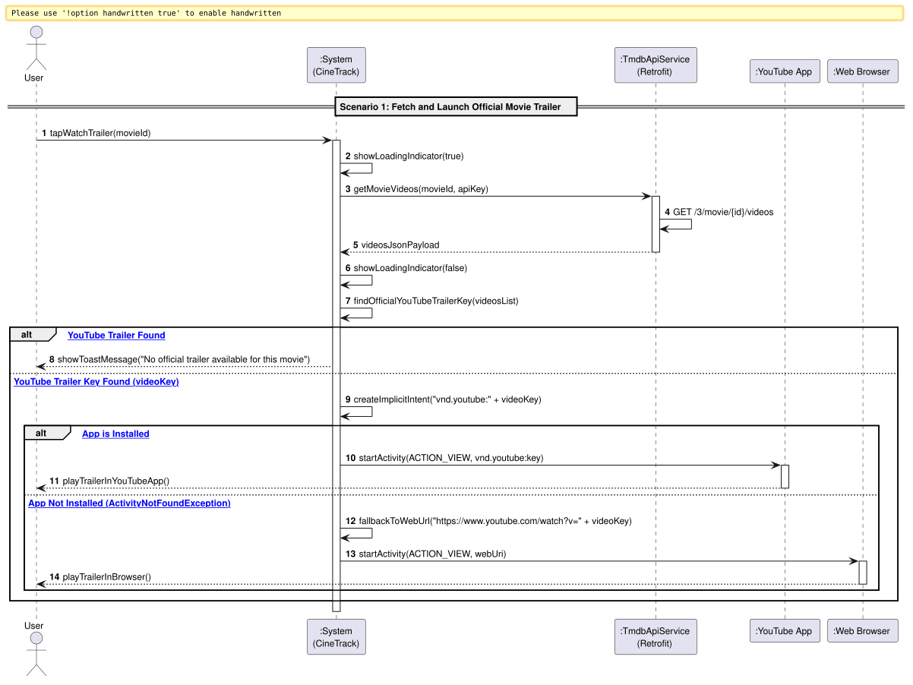

# US10: [Epic: API] Visualização de Trailers Oficiais (YouTube / Implicit Intent)

## 1. Descrição do Caso de Uso / User Story
Como um utilizador do CineTrack a consultar a ficha de um filme, pretendo assistir ao trailer oficial da obra cinematográfica através do YouTube, de modo a que a aplicação obtenha assincronamente a chave do vídeo a partir da API do TMDB e abra o leitor nativo do YouTube através de um *Implicit Intent*, assegurando um fallback automático para o navegador web caso a aplicação nativa não esteja instalada no dispositivo.

---

## 2. Critérios de Aceitação (Acceptance Criteria)
* **AC01 — Consulta Assíncrona do Endpoint de Vídeos (RNF04):** O sistema deve consultar o endpoint `/3/movie/{id}/videos` do TMDB via Retrofit 2 (`.enqueue()`), sem bloquear a *UI Thread*.
* **AC02 — Filtro do Trailer Oficial:** Na resposta JSON da API, o sistema deve pesquisar entradas onde o atributo `site` seja `"YouTube"` e o atributo `type` seja preferencialmente `"Trailer"` (com sinalizador `official: true` quando disponível).
* **AC03 — Disparo Defensivo de *Implicit Intent*:**
  * O sistema deve construir um `Intent` com ação `Intent.ACTION_VIEW` e URI nativo `Uri.parse("vnd.youtube:" + videoKey)`.
* **AC04 — Fallback Robusto para Navegador Web:**
  * Caso o dispositivo não tenha a aplicação do YouTube instalada (captura da exceção `ActivityNotFoundException`), o sistema deve disparar automaticamente um segundo `Intent` com o URL web (`https://www.youtube.com/watch?v=` + `videoKey`), prevenindo qualquer falha anómala (*crash*) da aplicação (RNF06).
* **AC05 — Feedback em Caso de Ausência de Trailer:** Caso o filme não possua nenhum trailer catalogado no TMDB, o sistema deve exibir uma notificação visual explicativa (*Toast* ou *Snackbar*).

---

## 3. Pré-condições e Pós-condições
* **Pré-condições:** O utilizador deve estar a visualizar a ficha de um filme com ligação ativa à Internet.
* **Pós-condições:** O trailer oficial é reproduzido na aplicação do YouTube ou no navegador de internet do dispositivo.

---

## 4. Fluxo Principal de Eventos
1. O utilizador encontra-se na ficha de detalhes de um filme (`MovieDetailActivity`) e clica no botão "Ver Trailer".
2. O sistema apresenta um indicador de carregamento e consulta assincronamente o endpoint `/3/movie/{id}/videos` via `TmdbApiService`.
3. O TMDB devolve a lista de vídeos associados à obra.
4. O sistema filtra a lista e extrai a chave (`key`) do trailer oficial do YouTube.
5. O sistema instancia um *Implicit Intent* com o esquema `vnd.youtube:<key>`.
6. O sistema tenta iniciar a atividade (`startActivity(intent)`).
7. O sistema operativo Android encaminha o pedido para a aplicação oficial do YouTube, iniciando a reprodução do trailer.

---

## 5. Fluxos Alternativos e Exceções
* **FA1 — Aplicação do YouTube Não Instalada (Fallback Web):**
  * No passo 6, é disparada a exceção `ActivityNotFoundException`.
  * O sistema captura defensivamente a exceção, altera o URI do `Intent` para `https://www.youtube.com/watch?v=<key>` e invoca novamente `startActivity(webIntent)`.
  * O navegador de internet padrão do utilizador abre o vídeo no YouTube.
* **E1 — Filme Sem Trailers no TMDB:**
  * No passo 4, se a lista não contiver nenhum vídeo válido, o sistema esconde o indicador de progresso e apresenta um aviso: *"Não foi encontrado nenhum trailer oficial para este filme"*.
* **E2 — Falha de Conexão à Internet:**
  * No passo 3, caso a chamada de rede falhe, o sistema informa o utilizador sobre o erro de comunicação sem fechar a janela.

---

## 6. Diagrama de Sequência de Sistema (SSD)

Ficheiro PlantUML fonte: [`puml/ssd_us10_trailers.puml`](puml/ssd_us10_trailers.puml)

---

## 7. Mapeamento Arquitetural (MVC)
* **Model:** [`SavedMovie.java`](../../../src/main/java/pt/isep/dssmv/projectdroid/model/SavedMovie.java).
* **Network & DTOs:** `TmdbApiService.java`, `TmdbVideosResponse.java`, `TmdbVideoDto.java`.
* **View:** Botão e componente visual em `activity_movie_detail.xml`.
* **Controller:** `MovieDetailActivity.java` orquestrando o *Implicit Intent* defensivo.
