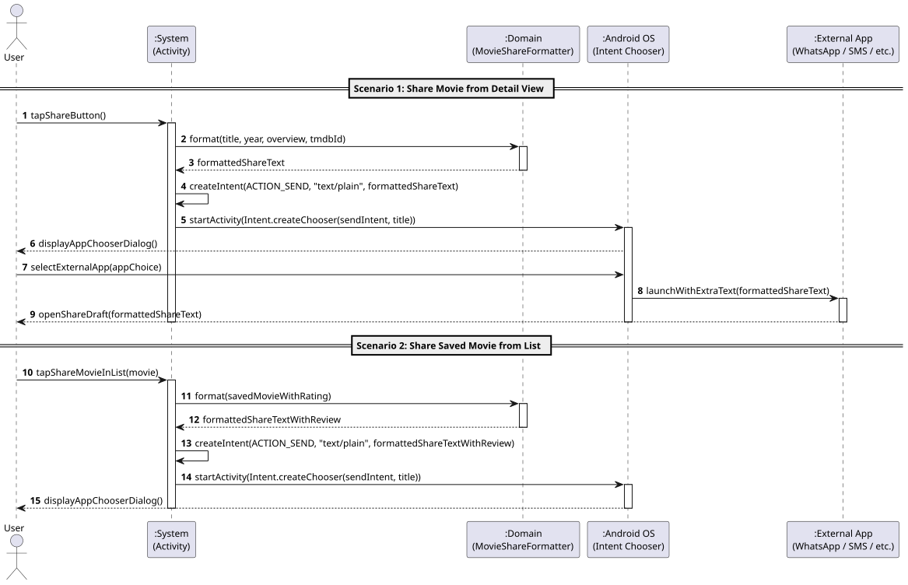

# US11: [Epic: Social] Partilha Externa de Fichas de Filmes

## 1. Descrição do Caso de Uso / User Story
Como um utilizador do CineTrack, pretendo partilhar facilmente os dados de um filme (título, ano de lançamento, sinopse, classificação pessoal, comentário e link oficial do TMDB) para aplicações externas de mensagens ou redes sociais (WhatsApp, Telegram, SMS, Email, etc.), utilizando o mecanismo nativo do Android (*Implicit Intent* com `Intent.createChooser()`), para que possa recomendar filmes aos meus amigos e contactos de forma prática.

---

## 2. Critérios de Aceitação (Acceptance Criteria)
* **AC01 — Formatação Estruturada no Domínio Puro:** A composição do texto social é realizada pela classe pura [`MovieShareFormatter.java`](../../../src/main/java/pt/isep/dssmv/projectdroid/model/MovieShareFormatter.java) no pacote de modelo, sem acoplamento a bibliotecas do Android SDK:
  * Apresenta cabeçalho com ícone e título (`🎬 Título (Ano)`).
  * Inclui classificação em estrelas e comentário pessoal, quando existentes.
  * Inclui o estado de visualização na coleção (`📌 Status`).
  * Inclui a sinopse truncada elegantemente se ultrapassar 300 caracteres.
  * Constrói a ligação canónica para a ficha pública no catálogo: `https://www.themoviedb.org/movie/{tmdbId}`.
* **AC02 — Mecanismo de Implicit Intent com Chooser:** O disparo da partilha utiliza `Intent.ACTION_SEND` com MIME type `text/plain`, encapsulado obrigatoriamente em `Intent.createChooser(sendIntent, title)` através do utilitário centralizado [`ShareHelper.java`](../../../src/main/java/pt/isep/dssmv/projectdroid/utils/ShareHelper.java).
* **AC03 — Pontos de Acesso Ubíquos na Aplicação:**
  * **Ecrã de Detalhe ([`MovieDetailActivity.java`](../../../src/main/java/pt/isep/dssmv/projectdroid/controllers/MovieDetailActivity.java)):** Botão de partilha dedicado na barra de topo (`buttonDetailShare`).
  * **Coleção / Listas de Filmes ([`ListDetailsActivity.java`](../../../src/main/java/pt/isep/dssmv/projectdroid/controllers/ListDetailsActivity.java)):** Botão de partilha em cada item de filme guardado no `RecyclerView` ([`SavedMovieAdapter.java`](../../../src/main/java/pt/isep/dssmv/projectdroid/adapters/SavedMovieAdapter.java)).
  * **Sugestão Aleatória por Agitação ([`MainActivity.java`](../../../src/main/java/pt/isep/dssmv/projectdroid/controllers/MainActivity.java)):** Acesso direto para partilhar o filme sorteado no diálogo do acelerómetro (*Shake Suggestion*).
* **AC04 — Cobertura de Testes Unitários:** O formatador de mensagens sociais dispõe de cobertura exaustiva em JUnit 5 ([`MovieShareFormatterTest.java`](../../../src/test/java/pt/isep/dssmv/projectdroid/model/MovieShareFormatterTest.java)), validando filmes completos, sem notas, sinopses extensas e entradas nulas/vazias.

---

## 3. Pré-condições e Pós-condições
* **Pré-condições:** O utilizador deve visualizar um filme no ecrã de detalhe, na sua lista de filmes ou no diálogo de sugestão por agitação.
* **Pós-condições:** O sistema operativo Android apresenta o seletor nativo de aplicações (*Chooser*) com o rascunho de texto formatado pronto para envio.

---

## 4. Fluxo Principal de Eventos
1. O utilizador clica no botão de partilha de um filme (no detalhe, na lista ou na sugestão do acelerómetro).
2. O sistema invoca `ShareHelper.shareSavedMovie(...)` ou `ShareHelper.shareMovie(...)`.
3. O `MovieShareFormatter` compõe a mensagem estruturada com título, ano, avaliação, sinopse e link TMDB.
4. O `ShareHelper` cria uma `Intent(Intent.ACTION_SEND)` com `text/plain` e dispara o `Intent.createChooser()`.
5. O Android exibe o menu contextual inferior com as aplicações disponíveis (WhatsApp, SMS, Email, etc.).
6. O utilizador seleciona a aplicação de destino e o sistema preenche a mensagem automaticamente.

---

## 5. Diagrama de Sequência de Sistema (SSD)

Ficheiro PlantUML fonte: [`puml/ssd_us11_share_movie.puml`](puml/ssd_us11_share_movie.puml)

---

## 6. Mapeamento Arquitetural (MVC)
* **Model:** [`MovieShareFormatter.java`](../../../src/main/java/pt/isep/dssmv/projectdroid/model/MovieShareFormatter.java), [`SavedMovie.java`](../../../src/main/java/pt/isep/dssmv/projectdroid/model/SavedMovie.java) e [`WatchStatus.java`](../../../src/main/java/pt/isep/dssmv/projectdroid/model/WatchStatus.java).
* **Utils:** [`ShareHelper.java`](../../../src/main/java/pt/isep/dssmv/projectdroid/utils/ShareHelper.java).
* **View:** `activity_movie_detail.xml` (botão `buttonDetailShare`), `item_saved_movie.xml` (botão `buttonShareMovie`) e `dialog_shake_suggestion.xml` (botão `buttonShakeShare`).
* **Adapters & Controllers:** [`SavedMovieAdapter.java`](../../../src/main/java/pt/isep/dssmv/projectdroid/adapters/SavedMovieAdapter.java), [`MovieDetailActivity.java`](../../../src/main/java/pt/isep/dssmv/projectdroid/controllers/MovieDetailActivity.java), [`ListDetailsActivity.java`](../../../src/main/java/pt/isep/dssmv/projectdroid/controllers/ListDetailsActivity.java) e [`MainActivity.java`](../../../src/main/java/pt/isep/dssmv/projectdroid/controllers/MainActivity.java).
* **Tests:** [`MovieShareFormatterTest.java`](../../../src/test/java/pt/isep/dssmv/projectdroid/model/MovieShareFormatterTest.java).
