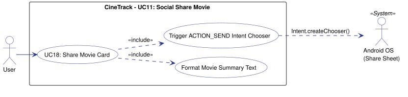
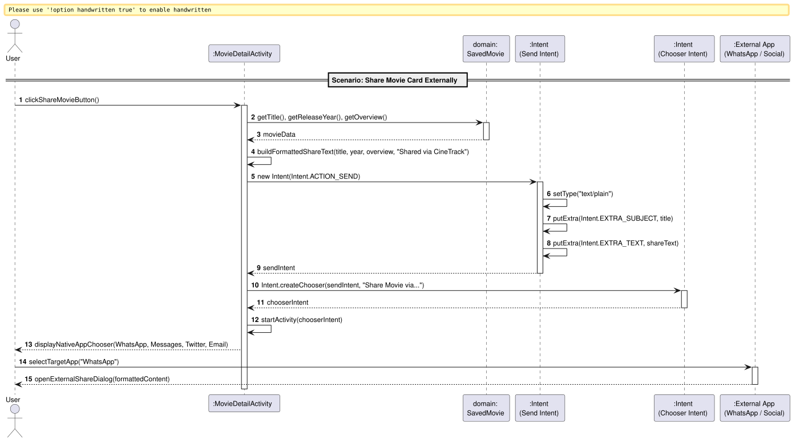

# US11: [Epic: Sharing] Partilha Social de Ficha de Filme (Intent Chooser)

## 1. Descrição do Caso de Uso / User Story
Como um utilizador do CineTrack, pretendo partilhar facilmente os detalhes e o resumo de um filme com amigos através de aplicações externas de mensagens ou redes sociais instaladas no meu dispositivo Android, para que possa recomendar títulos do catálogo ou da minha coleção pessoal.

---

## 2. Critérios de Aceitação (Acceptance Criteria)
* **AC01 — Formatação da Mensagem:** O texto partilhado deve incluir de forma legível o título do filme, o ano de lançamento, a sinopse e a avaliação/estado de visualização (quando partilhado a partir de uma lista pessoal).
* **AC02 — Utilização do Android Chooser:** O disparo da partilha deve recorrer a `Intent.createChooser(intent, title)` com ação `Intent.ACTION_SEND` e MIME type `text/plain`, garantindo que o utilizador pode selecionar qualquer aplicação compatível (WhatsApp, Telegram, Mensagens, Email, etc.).
* **AC03 — Resiliência:** Caso o utilizador cancele a folha de partilha nativa do Android, a aplicação deve retomar a interface anterior sem efeitos secundários ou interrupções.

---

## 3. Pré-condições e Pós-condições
* **Pré-condições:** O utilizador encontra-se no ecrã de detalhes de um filme ou num item de lista pessoal.
* **Pós-condições:** A folha de partilha do Android é exibida e o texto é transmitido para a aplicação selecionada pelo utilizador.

---

## 4. Fluxo Principal de Eventos
1. O utilizador clica no ícone de partilha na barra superior ou no cartão do filme.
2. O sistema formata a mensagem de texto com os metadados do filme.
3. O sistema cria um `Intent` com `ACTION_SEND` e tipo `text/plain`.
4. O sistema apresenta o seletor do Android (`Intent.createChooser`).
5. O utilizador seleciona a aplicação de destino para partilhar o texto.

---

## Diagrama de Caso de Uso Dedicado (UCD)
Ficheiro PlantUML fonte: [`puml/ucd_us11.puml`](puml/ucd_us11.puml)

---

## 5. Diagramas de Sequência

### 5.1. Diagrama de Sequência de Realização (SD — Nível de Design/Implementação)
Ficheiro PlantUML fonte: [`puml/sd_us11_social_share.puml`](puml/sd_us11_social_share.puml)

---

## 6. Mapeamento Arquitetural (MVC)
* **Model:** Entidade [`Movie.java`](../../../src/main/java/pt/isep/dssmv/projectdroid/model/Movie.java) e [`SavedMovie.java`](../../../src/main/java/pt/isep/dssmv/projectdroid/model/SavedMovie.java).
* **View:** `res/layout/activity_movie_detail.xml` e `res/layout/item_saved_movie.xml`.
* **Controller:** `MovieDetailActivity.java` e `ListDetailsActivity.java`.
