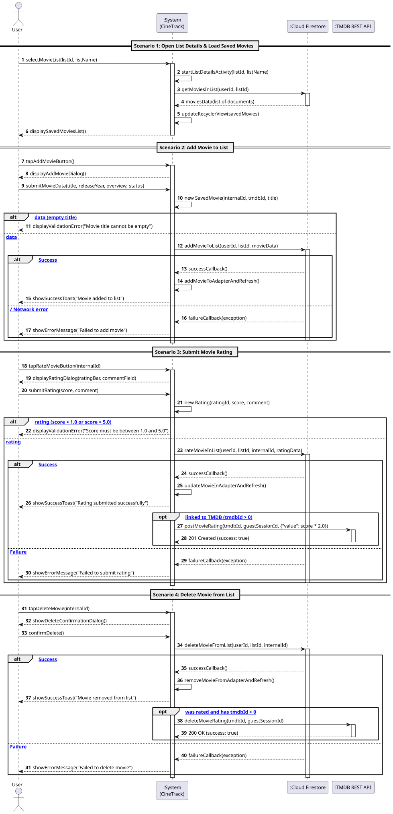

# US3: [Epic: CRUD] Adicionar Filmes às Listas e Submeter Avaliações

## 1. Descrição do Caso de Uso / User Story
Como um utilizador autenticado no CineTrack, pretendo aceder aos detalhes de uma coleção de filmes por mim criada, visualizar os filmes nela contidos, adicionar novos títulos (com definição do respetivo estado de visualização: *Plan to Watch*, *Watching*, *Watched*, *Favorite*) e registar avaliações quantitativas ($[1.0, 5.0]$ estrelas) com comentário facultativo, para que possa catalogar as minhas experiências cinematográficas de forma organizada e persistida no Cloud Firestore.

---

## 2. Critérios de Aceitação (Acceptance Criteria)
* **AC01 — Validação na Camada de Domínio Puro:** A criação e manipulação de filmes e avaliações baseia-se exclusivamente nas entidades puras [`SavedMovie.java`](../../../src/main/java/pt/isep/dssmv/projectdroid/model/SavedMovie.java) e [`Rating.java`](../../../src/main/java/pt/isep/dssmv/projectdroid/model/Rating.java).
  * Se o título do filme for nulo ou vazio, é obrigatoriamente lançada `InvalidDataException`.
  * Se a classificação atribuída for inferior a $1.0$ ou superior a $5.0$, é obrigatoriamente lançada `InvalidRatingException`, impedindo qualquer comunicação de rede ou persistência remota inválida.
* **AC02 — Navegação Contextual:** A partir da `MainActivity`, o clique sobre uma coleção dispara uma *Explicit Intent* com os extras `EXTRA_LIST_ID` e `EXTRA_LIST_NAME`, abrindo a atividade de detalhe [`ListDetailsActivity.java`](../../../src/main/java/pt/isep/dssmv/projectdroid/controllers/ListDetailsActivity.java).
* **AC03 — Listagem Assíncrona de Filmes (Read):** A `ListDetailsActivity` consulta a subcoleção `users/{userId}/lists/{listId}/movies` no Cloud Firestore e apresenta os filmes num `RecyclerView` com o adapter [`SavedMovieAdapter.java`](../../../src/main/java/pt/isep/dssmv/projectdroid/adapters/SavedMovieAdapter.java).
* **AC04 — Adição de Novo Filme (Create):** O utilizador pode acionar um diálogo modal para introduzir o título, ano de lançamento, sinopse e estado de visualização ([`WatchStatus`](../../../src/main/java/pt/isep/dssmv/projectdroid/model/WatchStatus.java)), persistindo o registo no Cloud Firestore.
* **AC05 — Avaliação e Classificação Numérica (Rate):** Cada filme guardado dispõe de uma opção para submeter ou atualizar a avaliação. O diálogo apresenta um componente visual `RatingBar` ($[1.0, 5.0]$ estrelas com incrementos de $0.5$) e um campo de texto para comentário, gravando a avaliação na base de dados e recalculando a média ou nota atribuída.
* **AC06 — Remoção de Filme (Delete):** Cada item permite a remoção do filme da lista mediante confirmação prévia num diálogo de alerta, eliminando o respetivo documento no Firestore e atualizando o `RecyclerView`.
* **AC07 — UI Thread Desimpedida:** Todas as operações de leitura, escrita e remoção no Cloud Firestore são estritamente assíncronas através de *listeners*, mantendo a interface reativa e fluida.
* **AC08 — Mutações REST com Retrofit (HTTP POST e DELETE):** Sempre que uma avaliação é registada num filme associado ao TMDB (`tmdbId > 0`), o `TmdbRatingManager` submete um pedido HTTP `POST /3/movie/{movie_id}/rating` com o corpo JSON `{"value": score * 2.0}` (`@Body` serializado por Gson) via Retrofit assíncrono, utilizando uma sessão de convidado gerida automaticamente. Caso um filme avaliado seja removido, é acionado o respetivo HTTP `DELETE`.

---

## 3. Pré-condições e Pós-condições
* **Pré-condições:** O utilizador deve estar previamente autenticado no Firebase Authentication e ter selecionado uma coleção válida na `MainActivity`.
* **Pós-condições:** Os filmes e avaliações são persistidos na subcoleção `users/{userId}/lists/{listId}/movies` do Cloud Firestore.

---

## 4. Fluxo Principal de Eventos
1. O utilizador clica numa coleção na `MainActivity`.
2. O sistema navega para a `ListDetailsActivity` e apresenta o cabeçalho com o nome da lista.
3. O sistema consulta assincronamente a subcoleção `users/{userId}/lists/{listId}/movies` no Firestore.
4. O Firestore devolve os documentos de filmes e o sistema renderiza-os no `RecyclerView`.
5. O utilizador clica no botão flutuante de adicionar filme (+).
6. O sistema apresenta o diálogo para preenchimento dos dados do filme (título, ano, sinopse e estado de visualização).
7. O utilizador preenche os dados e confirma a adição.
8. O sistema valida os dados com a entidade `SavedMovie` e persiste o documento no Cloud Firestore.
9. Após confirmação remota, o filme é adicionado ao `SavedMovieAdapter` e exibido de imediato com mensagem de sucesso (*Toast*).

---

## 5. Fluxos Alternativos e Exceções
* **FA1 — Avaliação de um Filme:**
  1. Na lista de filmes, o utilizador clica no botão "Avaliar".
  2. O sistema apresenta um diálogo com um `RatingBar` e um campo de comentário.
  3. O utilizador seleciona as estrelas desejadas (ex.: 4.5★), insere o comentário e submete.
  4. O sistema valida a classificação através da entidade `Rating`.
  5. Os dados da avaliação são persistidos assincronamente no Firestore e o item é atualizado na interface.
* **FA2 — Remoção de Filme:**
  1. O utilizador clica no botão de eliminar de um filme.
  2. O sistema apresenta o diálogo: *"Tem a certeza de que deseja remover este filme da lista?"*.
  3. O utilizador confirma e o documento correspondente é eliminado no Cloud Firestore.
  4. O item é removido do adapter com animação do `RecyclerView`.
* **E1 — Título do Filme Vazio:**
  * No passo 7, se o título estiver em branco, o sistema impede a chamada de rede e apresenta aviso no campo de texto.
* **E2 — Classificação Inválida:**
  * Se a classificação violar a restrição $[1.0, 5.0]$, a exceção checada `InvalidRatingException` é lançada e o utilizador é notificado.

---

## 6. Diagrama de Sequência de Sistema (SSD)

Ficheiro PlantUML fonte: [`puml/ssd_us3_add_movies_and_ratings.puml`](puml/ssd_us3_add_movies_and_ratings.puml)

---

## 7. Mapeamento Arquitetural (MVC)
* **Model:** [`SavedMovie.java`](../../../src/main/java/pt/isep/dssmv/projectdroid/model/SavedMovie.java), [`Rating.java`](../../../src/main/java/pt/isep/dssmv/projectdroid/model/Rating.java), [`WatchStatus.java`](../../../src/main/java/pt/isep/dssmv/projectdroid/model/WatchStatus.java), [`InvalidDataException.java`](../../../src/main/java/pt/isep/dssmv/projectdroid/exceptions/InvalidDataException.java) e [`InvalidRatingException.java`](../../../src/main/java/pt/isep/dssmv/projectdroid/exceptions/InvalidRatingException.java).
* **View:** `res/layout/activity_list_details.xml`, `res/layout/item_saved_movie.xml`, `res/layout/dialog_add_movie.xml` e `res/layout/dialog_rate_movie.xml` com dimensões rigorosamente em `dp` e tipografia em `sp`.
* **Adapter:** `SavedMovieAdapter.java` no pacote `pt.isep.dssmv.projectdroid.adapters`.
* **Backend / BaaS:** `FirestoreManager.java` no pacote `pt.isep.dssmv.projectdroid.firebase`.
* **REST Network (Mutações):** `TmdbRatingManager.java` e `TmdbApiService.java` (`POST` e `DELETE`) no pacote `pt.isep.dssmv.projectdroid.network`.
* **Controller:** `ListDetailsActivity.java` no pacote `pt.isep.dssmv.projectdroid.controllers`.
