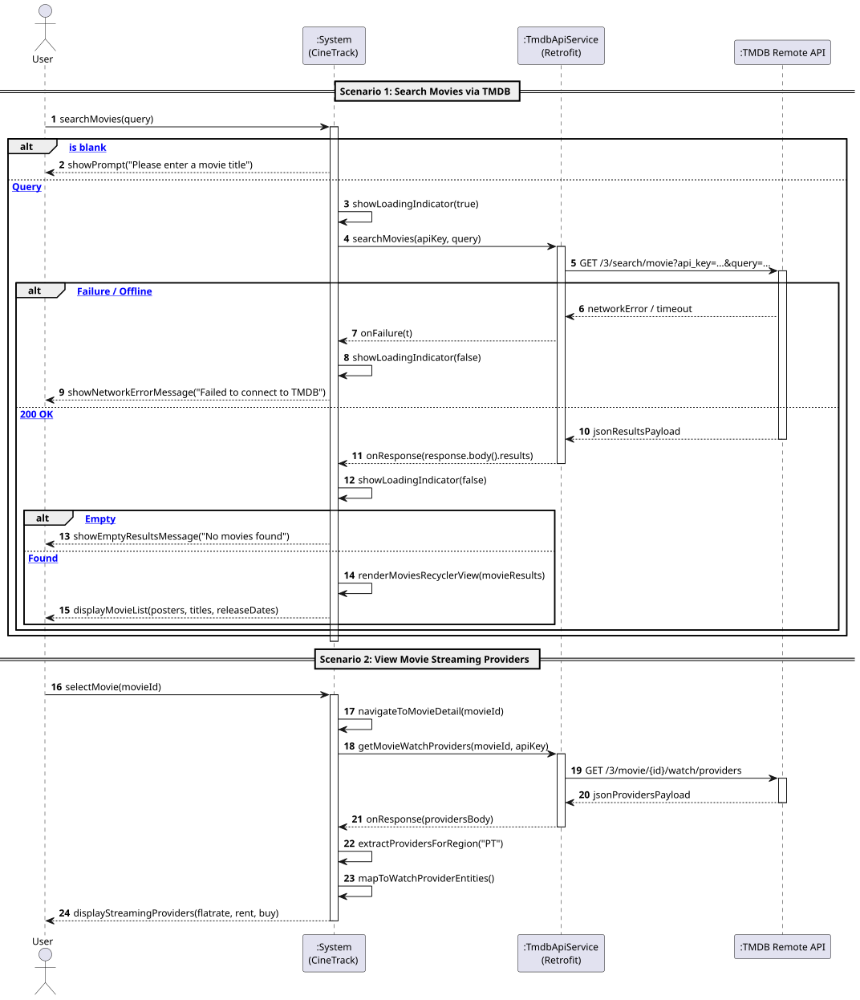

# US4: [Epic: API] Pesquisa de Filmes e Provedores de Streaming (TMDB)

## 1. Descrição do Caso de Uso / User Story
Como um utilizador do CineTrack, pretendo pesquisar filmes por título através da API externa do *The Movie Database* (TMDB) e consultar onde cada obra se encontra disponível para transmissão em streaming em Portugal (ou na região configurada), visualizando a sinopse, poster oficial, ano de lançamento e plataformas (ex.: Netflix, HBO Max, Disney+, Apple TV).

---

## 2. Critérios de Aceitação (Acceptance Criteria)
* **AC01 — Consumo de API REST com Retrofit 2 e Gson:** Os pedidos HTTP ao TMDB devem ser orquestrados através de uma instância centralizada do Retrofit (`RetrofitClient.java`) e da interface tipada `TmdbApiService.java`, serializados via Gson.
* **AC02 — Chamadas de Rede Assíncronas (RNF04):** Todos os pedidos de pesquisa (`/3/search/movie`) e provedores (`/3/movie/{id}/watch/providers`) devem ser executados assincronamente com o método `.enqueue(Callback<T>)`, sendo terminantemente proibidas chamadas síncronas (`.execute()`) na *UI Thread*.
* **AC03 — Segurança da Chave de API:** A chave de acesso à API nunca deve estar em código-fonte rígido (*hardcoded*), sendo injetada pelo Gradle via `BuildConfig.TMDB_API_KEY` a partir do ficheiro `.env`.
* **AC04 — Apresentação da Lista de Filmes:** A listagem de resultados é apresentada através de um `RecyclerView` com um layout declarativo XML (`item_movie_search.xml`) estilizado em `dp`/`sp`. O carregamento assíncrono dos posters a partir de URLs relativos da CDN do TMDB (`https://image.tmdb.org/t/p/w500/...`) deve recorrer à biblioteca Glide, com tratamento de placeholder de carregamento e imagem de erro.
* **AC05 — Mapeamento de Provedores para o Domínio:** Os provedores de streaming para o país configurado (por omissão `"PT"`) devem ser mapeados para a entidade pura [`WatchProvider.java`](../../../src/main/java/pt/isep/dssmv/projectdroid/model/WatchProvider.java), categorizados por tipo de acesso (`flatrate`, `buy`, `rent`).
* **AC06 — Tratamento Defensivo de Erros e Estado Vazio:** O sistema deve informar amigavelmente o utilizador em caso de ausência de conectividade, falha na API ou ausência de resultados para o termo pesquisado.

---

## 3. Pré-condições e Pós-condições
* **Pré-condições:** O dispositivo móvel deve ter ligação ativa à Internet e uma chave de API do TMDB configurada.
* **Pós-condições:** Os resultados da pesquisa e os provedores de streaming são apresentados na interface para consulta do utilizador.

---

## 4. Fluxo Principal de Eventos
1. O utilizador acede ao ecrã de pesquisa de filmes (`MovieSearchActivity`).
2. O utilizador introduz o termo de pesquisa no campo de texto e aciona o botão de pesquisa.
3. O sistema valida que a caixa de pesquisa não está em branco e exibe um indicador de progresso (`ProgressBar`).
4. O sistema invoca assincronamente o endpoint `/3/search/movie` via `TmdbApiService.searchMovies(...)`.
5. O TMDB devolve o conjunto de resultados paginados em JSON.
6. O sistema popula o `RecyclerView` através do `MovieSearchAdapter`, despoletando o carregamento dos posters via Glide.
7. O utilizador clica sobre um filme da lista para ver mais detalhes.
8. O sistema consulta assincronamente o endpoint `/3/movie/{id}/watch/providers`.
9. O sistema filtra os provedores associados a Portugal (`results.PT`) e mapeia-os em instâncias de `WatchProvider`.
10. O sistema renderiza a ficha de detalhe com sinopse, poster e lista de logótipos dos canais de streaming.

---

## 5. Fluxos Alternativos e Exceções
* **FA1 — Filme Sem Provedores Disponíveis em Portugal:**
  * No passo 9, caso a resposta não contenha o nó `PT` ou não haja fornecedores de subscrição (`flatrate`), o sistema exibe uma mensagem informativa: *"Sem serviços de streaming disponíveis em Portugal"*.
* **E1 — Termo de Pesquisa Vazio:**
  * No passo 3, se o termo estiver em branco, o sistema não efetua chamada de rede e apresenta aviso no ecrã.
* **E2 — Falha de Conexão à Internet / Timeout:**
  * No passo 5 ou 8, caso ocorra exceção de rede (`onFailure`), o sistema esconde o `ProgressBar` e exibe um `Snackbar` ou `Toast` de erro sem fechar a aplicação (*crash*).

---

## 6. Diagrama de Sequência de Sistema (SSD)

Ficheiro PlantUML fonte: [`puml/ssd_us4_search_tmdb.puml`](puml/ssd_us4_search_tmdb.puml)

---

## 7. Mapeamento Arquitetural (MVC)
* **Model:** [`SavedMovie.java`](../../../src/main/java/pt/isep/dssmv/projectdroid/model/SavedMovie.java), [`WatchProvider.java`](../../../src/main/java/pt/isep/dssmv/projectdroid/model/WatchProvider.java) e [`InvalidDataException.java`](../../../src/main/java/pt/isep/dssmv/projectdroid/exceptions/InvalidDataException.java).
* **Network & DTOs:** `RetrofitClient.java`, `TmdbApiService.java`, e DTOs (`TmdbSearchResponse`, `TmdbMovieDto`, `TmdbWatchProvidersResponse`) no pacote `pt.isep.dssmv.projectdroid.network`.
* **Views & Adapters:** `activity_movie_search.xml`, `item_movie_search.xml`, `item_watch_provider.xml` e `MovieSearchAdapter.java`.
* **Controllers:** `MovieSearchActivity.java` e `MovieDetailActivity.java` no pacote `pt.isep.dssmv.projectdroid.controllers`.
