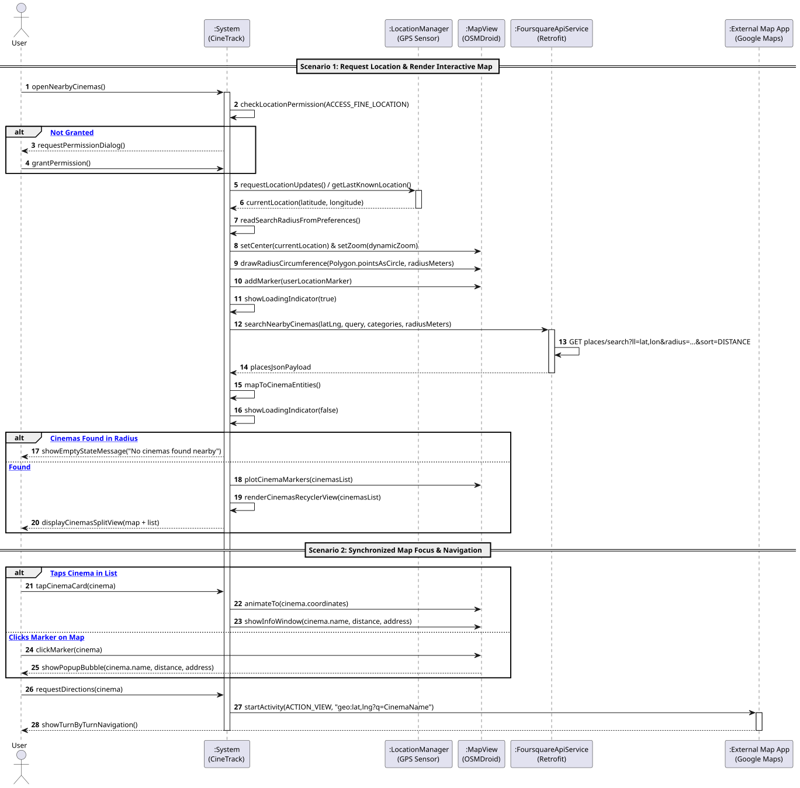

# US5: [Epic: Mapas] Localizar Salas de Cinema Próximas (GPS + Foursquare)

## 1. Descrição do Caso de Uso / User Story
Como um utilizador do CineTrack, pretendo localizar salas de cinema nas minhas imediações geográficas com base nas coordenadas de GPS do dispositivo e num raio configurável, visualizando os nomes, moradas e distâncias calculadas, podendo abrir as direções de navegação diretamente numa aplicação de mapas externa (como o Google Maps).

---

## 2. Critérios de Aceitação (Acceptance Criteria)
* **AC01 — Gestão de Permissões em Tempo de Execução (*Runtime Permissions*):** O sistema deve verificar a permissão `ACCESS_FINE_LOCATION`. Caso não esteja concedida, deve apresentar o diálogo nativo do Android solicitando autorização com explicação clara do motivo. Se negada, deve informar o utilizador sem bloquear a aplicação (RNF06).
* **AC02 — Obtenção de Coordenadas GPS Nativas:** A localização do utilizador deve ser recolhida através do hardware nativo (`LocationManager` com `GPS_PROVIDER` ou `NETWORK_PROVIDER`).
* **AC03 — Integração REST com a Foursquare Places API:** O sistema deve consultar assincronamente o endpoint de pesquisa de POIs (`/v3/places/search`) com a categoria de salas de cinema (`10024`), passando as coordenadas atuais e o raio configurado no `SharedPrefManager`.
* **AC04 — Segurança de Chaves:** A autenticação na API da Foursquare deve recorrer ao cabeçalho `Authorization` injetado via `BuildConfig.FOURSQUARE_API_KEY`.
* **AC05 — Mapeamento para o Domínio:** Cada resultado é instanciado na entidade pura [`Cinema.java`](../../../src/main/java/pt/isep/dssmv/projectdroid/model/Cinema.java), preenchendo identificador Foursquare, nome, latitude, longitude, morada e distância em metros.
* **AC06 — Navegação Externa via Implicit Intent:** Ao clicar num cinema ou ação de direções, o sistema deve disparar um *Implicit Intent* com ação `Intent.ACTION_VIEW` e esquema `geo:latitude,longitude?q=Nome+do+Cinema` para abrir a aplicação de navegação externa (Google Maps, Waze, etc.).

---

## 3. Pré-condições e Pós-condições
* **Pré-condições:** O dispositivo deve ter o serviço de localização/GPS ativado, conectividade à Internet e autorização de permissão concedida.
* **Pós-condições:** As salas de cinema encontradas são apresentadas num `RecyclerView` ordenadas pela distância calculada ao utilizador.

---

## 4. Fluxo Principal de Eventos
1. O utilizador acede ao ecrã de cinemas próximos (`CinemasActivity`).
2. O sistema verifica as permissões de localização. Estando autorizadas, obtém a última posição conhecida ou solicita atualização ao GPS.
3. O sistema lê o raio de pesquisa configurado nas preferências locais via `SharedPrefManager`.
4. O sistema exibe um indicador de carregamento (`ProgressBar`) e submete o pedido assíncrono à Foursquare Places API via Retrofit (`.enqueue()`).
5. A Foursquare API devolve os locais correspondentes em JSON.
6. O sistema valida e instancia os objetos de domínio `Cinema`.
7. O sistema apresenta a listagem de cinemas no `RecyclerView` através do `CinemaAdapter`.
8. O utilizador seleciona um cinema para obter rota.
9. O sistema constrói e dispara um *Implicit Intent* com o URI geográfico (`geo:...`).
10. O Android abre o seletor ou a aplicação de mapas externa apresentando a rota.

---

## 5. Fluxos Alternativos e Exceções
* **FA1 — Permissão de Localização Recusada:**
  * No passo 2, se o utilizador recusar a permissão `ACCESS_FINE_LOCATION`, o sistema exibe um aviso explicativo e oferece um botão para tentar novamente ou abrir as definições da aplicação, não bloqueando a aplicação.
* **FA2 — GPS Desativado no Dispositivo:**
  * No passo 2, caso o provedor de localização esteja desligado, o sistema alerta o utilizador sugerindo a ativação dos serviços de localização.
* **E1 — Nenhum Cinema Encontrado no Raio:**
  * No passo 5, caso a lista de resultados esteja vazia, o sistema oculta a lista e apresenta o estado vazio (*Empty State*), sugerindo aumentar o raio de pesquisa nas preferências.
* **E2 — Falha de Conexão à Internet:**
  * No passo 4, se a chamada de rede falhar, o sistema apresenta um aviso de erro e desativa o indicador de progresso.

---

## 6. Diagrama de Sequência de Sistema (SSD)

Ficheiro PlantUML fonte: [`puml/ssd_us5_nearby_cinemas.puml`](puml/ssd_us5_nearby_cinemas.puml)

---

## 7. Mapeamento Arquitetural (MVC)
* **Model:** [`Cinema.java`](../../../src/main/java/pt/isep/dssmv/projectdroid/model/Cinema.java) e [`InvalidDataException.java`](../../../src/main/java/pt/isep/dssmv/projectdroid/exceptions/InvalidDataException.java).
* **Network & Services:** `FoursquareApiService.java`, DTOs (`FsqPlacesResponse`, `FsqPlaceDto`), e `LocationHelper.java`.
* **Views & Adapters:** `activity_cinemas.xml`, `item_cinema.xml` e `CinemaAdapter.java`.
* **Controller:** `CinemasActivity.java` no pacote `pt.isep.dssmv.projectdroid.controllers`.
