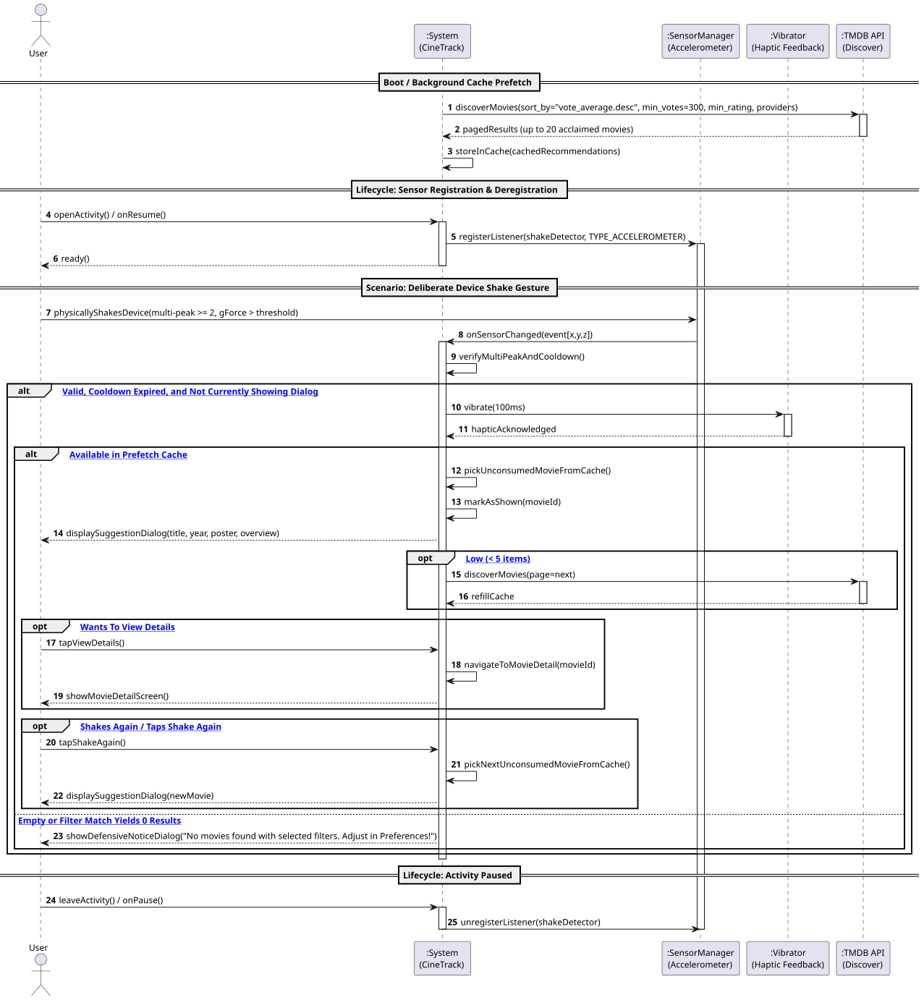
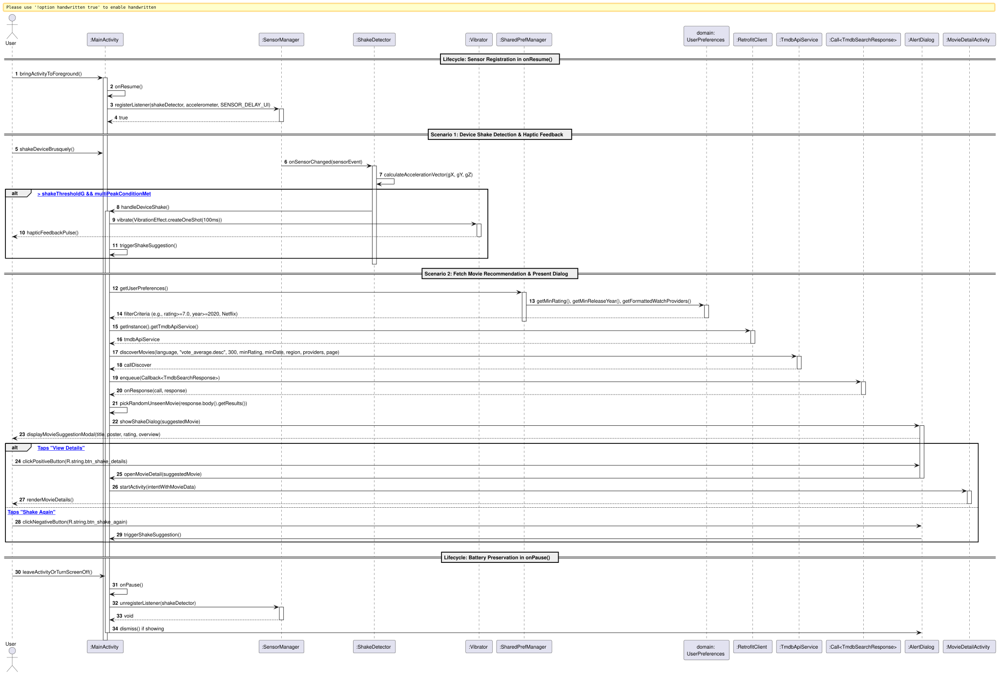

# US6: [Epic: Hardware] Sugestão Inteligente ao Agitar o Dispositivo (Acelerómetro)

## 1. Descrição do Caso de Uso / User Story
Como um utilizador do CineTrack indeciso sobre que filme assistir, pretendo agitar fisicamente o meu smartphone (*Shake to Suggest*) para que a aplicação selecione e me apresente instantaneamente uma recomendação cinematográfica aclamada da API TMDB Discover (filtrada pelas minhas preferências de avaliação mínima, ano e serviços de streaming subscritos), acompanhada por um ligeiro feedback tátil/vibração e um diálogo modal com o título, poster e sinopse do filme sorteado, sem duplicados e sem sobreposição de diálogos.

---

## 2. Critérios de Aceitação (Acceptance Criteria)
* **AC01 — Leitura de Aceleração com o Sensor Nativo:** A deteção do movimento físico deve recorrer à classe nativa `SensorManager` e ao acelerómetro do hardware (`Sensor.TYPE_ACCELEROMETER`), encapsulada na classe utilitária `ShakeDetector.java` (implementando `SensorEventListener`).
* **AC02 — Deteção Multi-Pico e Limiar Calibrado:** Para evitar falsos positivos resultantes de movimentos suaves, rotação ou pegar no telefone, o detetor deve exigir pelo menos **dois picos de aceleração em direções opostas** num intervalo de até $900\text{ ms}$, com limiar configurável (Normal: $3.2g$, Alta sensibilidade: $2.7g$, Baixa: $3.8g$):
  $$g = \frac{\sqrt{a_x^2 + a_y^2 + a_z^2}}{g_0}$$
* **AC03 — Prevenção de Múltiplos Disparos (*Debounce*) e Bloqueio de Stacking:**
  * Cooldown de arrefecimento de pelo menos $1200\text{ ms}$ após cada disparo.
  * Sinalizadores defensivos (`isShakeDialogOpen` e `isShakeLoading`) e listeners de ciclo de vida do diálogo (`setOnShowListener` e `setOnDismissListener`) impedindo categoricamente que novos diálogos sejam empilhados se o utilizador continuar a agitar o telefone com um diálogo aberto.
* **AC04 — Gestão Rigorosa do Ciclo de Vida da Activity (Preservação de Bateria):** O listener do sensor de hardware deve ser **registado obrigatoriamente no método `onResume()`** e **desregistado no método `onPause()`** da `Activity`. Deixar o acelerómetro ativo em background é expressamente proibido para salvaguardar a bateria do dispositivo.
* **AC05 — Feedback Háptico Suave:** Ao detetar a agitação com sucesso, o sistema deve fornecer uma vibração suave (via `Vibrator` ou `VibrationEffect.createOneShot(100)`), indicando ao utilizador que o gesto foi reconhecido.
* **AC06 — Cache de Pré-Carregamento (20 Filmes) e Zero Repetições:**
  * Ao iniciar a aplicação (`onCreate()`), o sistema pré-carrega em background uma lista de 20 filmes aclamados via TMDB Discover (`vote_average.desc`, `vote_count.gte=300`).
  * Cada agitação retira instantaneamente um filme não consumido da cache local (sem latência de rede) e regista o identificador em histórico (`shownRecommendationMovieIds`), garantindo **zero repetições**.
  * Quando a cache restante desce abaixo de 5 títulos, o sistema efetua automaticamente novo prefetch em background da página seguinte.
* **AC07 — Filtragem por Preferências e Serviços de Streaming:** A seleção de filmes respeita a nota mínima do utilizador, ano de lançamento e os serviços de streaming subscritos (Netflix, HBO Max, Disney+, Prime Video, Apple TV+).
* **AC08 — Estado Vazio Defensivo:** Se nenhuma obra corresponder aos filtros configurados, o sistema exibe um diálogo explicativo sugerindo a revisão dos filtros nas Preferências.

---

## 3. Pré-condições e Pós-condições
* **Pré-condições:** O dispositivo Android deve possuir sensor de acelerómetro e a aplicação deve estar no primeiro plano (*foreground*).
* **Pós-condições:** Um diálogo modal com o filme sugerido é apresentado com opções "Ver Detalhes", "Sortear Outro" ou fechar.

---

## 4. Fluxo Principal de Eventos
1. A aplicação inicia e executa `prefetchRecommendations()`, pré-carregando 20 filmes de topo na cache em background.
2. O utilizador encontra-se no ecrã da aplicação (`onResume()`), onde o `ShakeDetector` é registado no `SensorManager`.
3. O utilizador agita deliberadamente o dispositivo (comprovado por $\ge 2$ picos acima do limiar configurado).
4. O `ShakeDetector` notifica o listener e ativa vibração curta de confirmação.
5. O sistema verifica os sinalizadores `isShakeDialogOpen` e `isShakeLoading`. Estando livres, avança.
6. O sistema consome um filme aleatório da cache local e regista o seu ID para evitar repetições.
7. O sistema exibe o diálogo modal com o título, ano, poster e sinopse da obra.
8. Se a cache descer abaixo de 5 itens, o sistema dispara prefetch da página seguinte em background.
9. O utilizador pode clicar em "Ver Detalhes" para abrir a ficha completa do filme, ou "Sortear Outro" para obter uma nova sugestão imediata da cache.

---

## 5. Fluxos Alternativos e Exceções
* **FA1 — Utilizador Clica em "Sortear Outro":**
  * O diálogo atual é encerrado e o sistema extrai de imediato o próximo filme não consumido da cache.
* **FA2 — Alteração de Filtros nas Preferências:**
  * Ao gravar novas preferências, a cache e o histórico de exibição são invalidados e é executado um novo prefetch com os novos critérios.
* **E1 — Nenhum Filme Disponível com os Filtros:**
  * Caso os filtros do utilizador sejam excessivamente restritos e não devolvam resultados, o sistema apresenta o diálogo defensivo com atalho direto para as Preferências.

---

## 6. Diagramas de Sequência

### 6.1. Diagrama de Sequência de Sistema (SSD — Nível de Análise)
Ficheiro PlantUML fonte: [`puml/ssd_us6_shake_suggest.puml`](puml/ssd_us6_shake_suggest.puml)

### 6.2. Diagrama de Sequência de Realização (SD — Nível de Design/Implementação)
Ficheiro PlantUML fonte: [`puml/sd_us6_shake_suggest.puml`](puml/sd_us6_shake_suggest.puml)

---

## 7. Mapeamento Arquitetural (MVC)
* **Model:** [`UserPreferences.java`](../../../src/main/java/pt/isep/dssmv/projectdroid/model/UserPreferences.java).
* **Hardware & Sensor Service:** `ShakeDetector.java` no pacote `pt.isep.dssmv.projectdroid.utils`.
* **Network & Cache:** `TmdbApiService.java` (`discoverMovies`), `cachedRecommendations`, `shownRecommendationMovieIds` em `MainActivity.java`.
* **Views:** `dialog_shake_suggestion.xml` concebido com dimensões estritamente em `dp`/`sp`.
* **Controller:** `MainActivity.java` gerindo `onResume()`, `onPause()` e o ciclo de vida dos diálogos.
