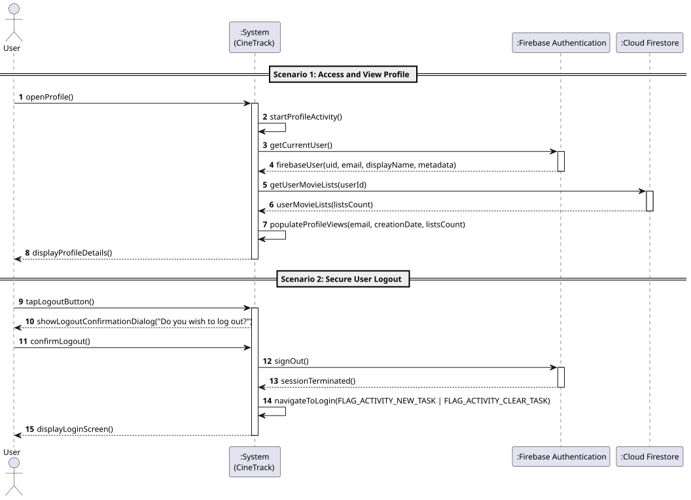

# US7: [Epic: Auth] Gestão de Perfil do Utilizador e Logout

## 1. Descrição do Caso de Uso / User Story
Como um utilizador autenticado no CineTrack, pretendo aceder a um ecrã dedicado ao meu perfil pessoal para consultar os metadados da minha conta (nome/email, identificador único, data de registo, estatísticas de utilização) e terminar a minha sessão de forma segura, para que possa gerir os meus dados e garantir a privacidade das minhas listas após utilizar a aplicação.

---

## 2. Critérios de Aceitação (Acceptance Criteria)
* **AC01 — Consulta de Dados da Conta:** O ecrã [`ProfileActivity.java`](../../../src/main/java/pt/isep/dssmv/projectdroid/controllers/ProfileActivity.java) deve apresentar o email do utilizador autenticado, o seu Firebase UID e a data de criação da conta (formatada via `FirebaseUser.getMetadata().getCreationTimestamp()`).
* **AC02 — Métricas e Estatísticas de Utilização:** O sistema deve consultar o Cloud Firestore e apresentar a contagem total de coleções criadas pelo utilizador (`users/{userId}/lists`).
* **AC03 — Encerramento Seguro de Sessão (Logout):** Ao selecionar a opção de logout, o sistema apresenta um diálogo de confirmação prévia. Se o utilizador confirmar, a sessão no Firebase Authentication é terminada de imediato (`FirebaseAuth.getInstance().signOut()`).
* **AC04 — Limpeza Estrita da Pilha de Atividades (Back Stack):** Após o encerramento da sessão, a navegação para a `LoginActivity` deve obrigatoriamente utilizar as flags `Intent.FLAG_ACTIVITY_NEW_TASK | Intent.FLAG_ACTIVITY_CLEAR_TASK`, impedindo formalmente que o utilizador consiga aceder novamente aos ecrãs autenticados premindo o botão físico de recuo (*Back*).
* **AC05 — Navegação Intuitiva:** O ecrã principal (`MainActivity`) disponibiliza um botão de acesso direto ao perfil no cabeçalho superior. A partir do perfil, o utilizador pode regressar facilmente ao ecrã principal através do botão de recuo.
* **AC06 — UI Thread Desimpedida:** As consultas e encerramentos de sessão decorrem de forma assíncrona, respeitando a fluidez da interface.

---

## 3. Pré-condições e Pós-condições
* **Pré-condições:** O utilizador deve possuir sessão iniciada no Firebase Authentication.
* **Pós-condições:** Ao efetuar logout, o token de autenticação local é revogado e o utilizador é redirecionado para o ecrã de início de sessão.

---

## 4. Fluxo Principal de Eventos
1. O utilizador clica no ícone de perfil no cabeçalho da `MainActivity`.
2. O sistema navega para a `ProfileActivity`.
3. O sistema obtém os dados do utilizador autenticado a partir do `FirebaseAuthManager`.
4. O sistema consulta o Cloud Firestore pelas coleções do utilizador para apurar as métricas da conta.
5. O sistema apresenta o email, identificador, data de registo e o total de listas criadas.
6. O utilizador clica no botão "Terminar Sessão" (*Log Out*).
7. O sistema exibe o diálogo de confirmação.
8. O utilizador confirma o encerramento da sessão.
9. O sistema invoca `signOut()` no Firebase Auth e redireciona para a `LoginActivity` limpando a pilha de atividades.

---

## 5. Fluxos Alternativos e Exceções
* **FA1 — Cancelamento do Logout:**
  * No passo 8, o utilizador cancela o diálogo de encerramento da sessão. O sistema fecha o diálogo e mantém o utilizador no ecrã de perfil com a sessão ativa.
* **FA2 — Regresso ao Ecrã Principal:**
  * O utilizador clica no botão de recuo no topo do ecrã de perfil. O sistema fecha a `ProfileActivity` e volta à `MainActivity`.
* **E1 — Ausência de Sessão Ativa:**
  * Se a `ProfileActivity` for acionada sem um utilizador autenticado válido, o sistema redireciona imediatamente para a `LoginActivity`.

---

## 6. Diagrama de Sequência de Sistema (SSD)

Ficheiro PlantUML fonte: [`puml/ssd_us7_profile_logout.puml`](puml/ssd_us7_profile_logout.puml)

---

## 7. Mapeamento Arquitetural (MVC)
* **Model:** [`User.java`](../../../src/main/java/pt/isep/dssmv/projectdroid/model/User.java) e [`MovieList.java`](../../../src/main/java/pt/isep/dssmv/projectdroid/model/MovieList.java).
* **View:** `res/layout/activity_profile.xml` com dimensões rigorosamente em `dp` e tipografia em `sp`.
* **Backend / BaaS:** `FirebaseAuthManager.java` e `FirestoreManager.java`.
* **Controller:** `ProfileActivity.java` no pacote `pt.isep.dssmv.projectdroid.controllers`.
