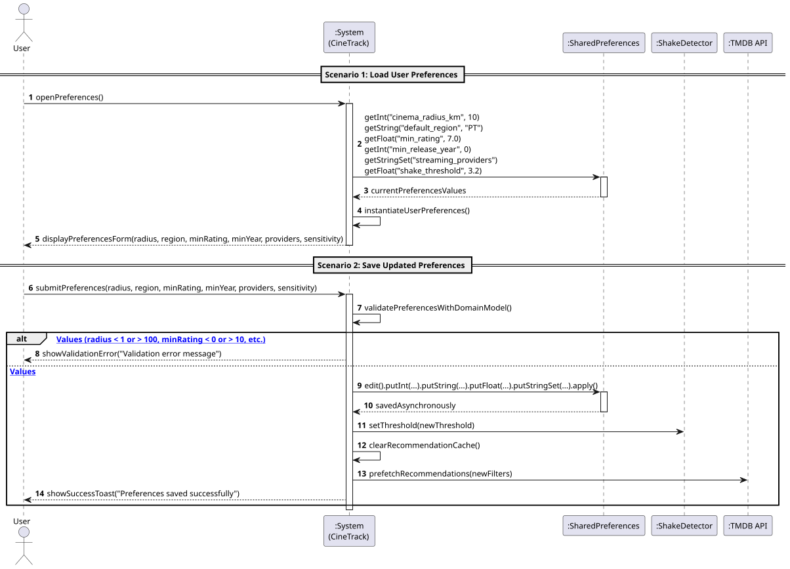
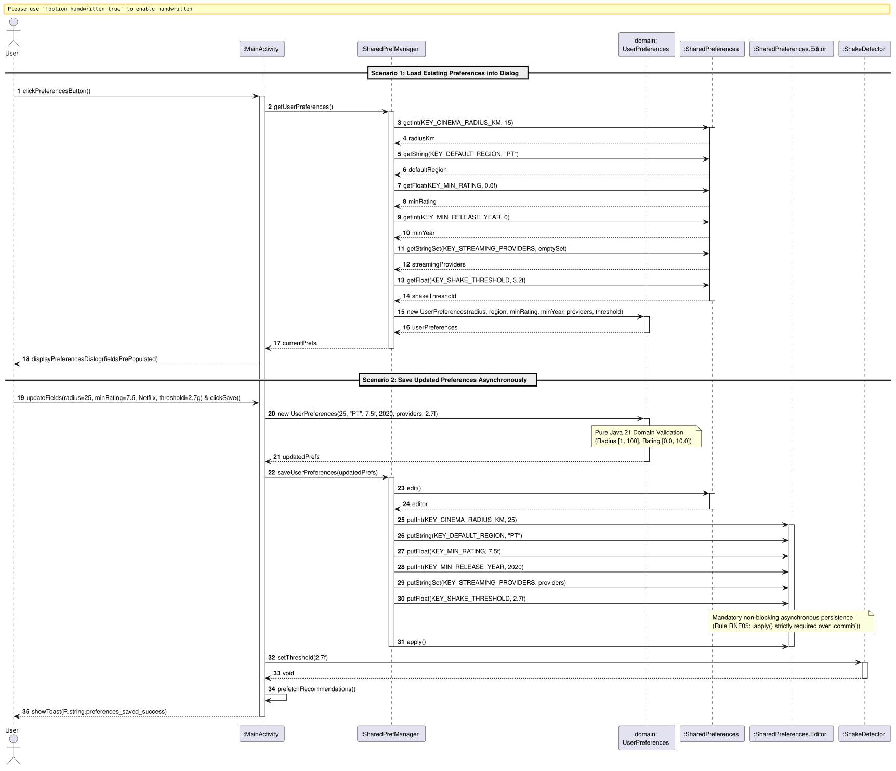

# US8: [Epic: Persistence] Guardar Preferências Locais (SharedPreferences)

## 1. Descrição do Caso de Uso / User Story
Como um utilizador do CineTrack, pretendo configurar e persistir localmente as minhas preferências de aplicação (nomeadamente o raio de pesquisa de cinemas, o país/região padrão, filtros de recomendação como nota mínima e ano de lançamento, serviços de streaming subscritos e a sensibilidade do acelerómetro), de modo a que a aplicação preserve estas definições de forma duradoura entre sessões e sem efetuar operações síncronas que afetem a fluidez da interface gráfica (*UI Thread*).

---

## 2. Critérios de Aceitação (Acceptance Criteria)
* **AC01 — Validação na Camada de Domínio Puro:** Os dados são validados estritamente pela entidade pura [`UserPreferences.java`](../../../src/main/java/pt/isep/dssmv/projectdroid/model/UserPreferences.java):
  * Raio de busca entre $1$ e $100\text{ km}$.
  * Região padrão não nula nem vazia (ex.: `"PT"`).
  * Nota mínima entre $0.0$ e $10.0$ (omissão: $7.0$).
  * Ano mínimo de lançamento $\ge 1888$ ou $0$ para desativar filtro.
  * Conjunto de fornecedores de streaming subscritos (`Set<String>`).
  * Limiar de sensibilidade de agitação positivo ($>0.0g$).
  * Violações disparam a exceção checada [`InvalidDataException.java`](../../../src/main/java/pt/isep/dssmv/projectdroid/exceptions/InvalidDataException.java).
* **AC02 — Valores Padrão (Fallbacks):** Caso o utilizador nunca tenha gravado preferências, o sistema assume: raio de $10\text{ km}$, região `"PT"`, nota mínima $7.0$, sem restrição de ano ($0$), sem restrição de streaming (todos disponíveis) e sensibilidade normal ($3.2g$).
* **AC03 — Persistência Não-Bloqueante (RNF05):** A escrita de preferências em `SharedPreferences` deve ser realizada imperativa e exclusivamente através de **`.apply()`** (execução assíncrona em background). É **estritamente proibido** o recurso a `.commit()` (síncrono/bloqueante).
* **AC04 — Encapsulamento em Gestor Centralizado:** O acesso a `SharedPreferences` deve ser encapsulado na classe utilitária `SharedPrefManager.java` (padrão Singleton com `Context.getSharedPreferences`), protegendo a lógica das *Activities*.
* **AC05 — Design Responsivo de Interface (RNF03):** O diálogo de preferências é desenhado em XML (`dialog_preferences.xml`) usando estritamente unidades **`dp`** e **`sp`**, com `ScrollView` para acomodar ecrãs de diferentes dimensões e orientações.
* **AC06 — Invalidação de Cache de Recomendações:** Ao gravar novas preferências, a aplicação invalida automaticamente a cache e o histórico de sugestões do *Shake to Suggest*, reiniciando o prefetch com os novos critérios.

---

## 3. Pré-condições e Pós-condições
* **Pré-condições:** A aplicação deve estar em execução no dispositivo Android.
* **Pós-condições:** As preferências são gravadas em ficheiro XML privado de `SharedPreferences` no armazenamento interno do dispositivo (`/data/data/pt.isep.dssmv.projectdroid/shared_prefs/`).

---

## 4. Fluxo Principal de Eventos
1. O utilizador clica no botão de Preferências (ícone de engrenagem) na barra de ferramentas.
2. O sistema consulta `SharedPrefManager` e obtém a instância de `UserPreferences`.
3. O sistema apresenta o formulário preenchido com as configurações ativas (raio, região, nota mínima, ano, checkboxes de streaming e spinner de sensibilidade).
4. O utilizador efetua os ajustes pretendidos e clica em "Guardar".
5. O sistema instancia `UserPreferences` com os novos valores, validando as regras no domínio puro.
6. O sistema invoca `SharedPrefManager.saveUserPreferences(...)`, persistindo com `.apply()`.
7. O sistema atualiza o limiar do `ShakeDetector`, invalida a cache de recomendações e dispara um novo prefetch em background.
8. O sistema apresenta feedback de sucesso (*Toast*) e fecha o diálogo.

---

## 5. Fluxos Alternativos e Exceções
* **E1 — Valor de Raio ou Nota Inválido:**
  * No passo 5, se algum valor violar as restrições de validação, o domínio lança `InvalidDataException`.
  * O sistema captura a exceção, não persiste os dados e exibe mensagem de erro.

---

## 6. Diagramas de Sequência

### 6.1. Diagrama de Sequência de Sistema (SSD — Nível de Análise)
Ficheiro PlantUML fonte: [`puml/ssd_us8_preferences.puml`](puml/ssd_us8_preferences.puml)

### 6.2. Diagrama de Sequência de Realização (SD — Nível de Design/Implementação)
Ficheiro PlantUML fonte: [`puml/sd_us8_preferences.puml`](puml/sd_us8_preferences.puml)

---

## 7. Mapeamento Arquitetural (MVC)
* **Model:** [`UserPreferences.java`](../../../src/main/java/pt/isep/dssmv/projectdroid/model/UserPreferences.java) e [`InvalidDataException.java`](../../../src/main/java/pt/isep/dssmv/projectdroid/exceptions/InvalidDataException.java).
* **View:** `dialog_preferences.xml` usando `dp`/`sp`.
* **Persistence / Manager:** `SharedPrefManager.java` no pacote `pt.isep.dssmv.projectdroid.utils`.
* **Controller:** `MainActivity.java` gerindo a apresentação do diálogo e o ciclo de persistência.
