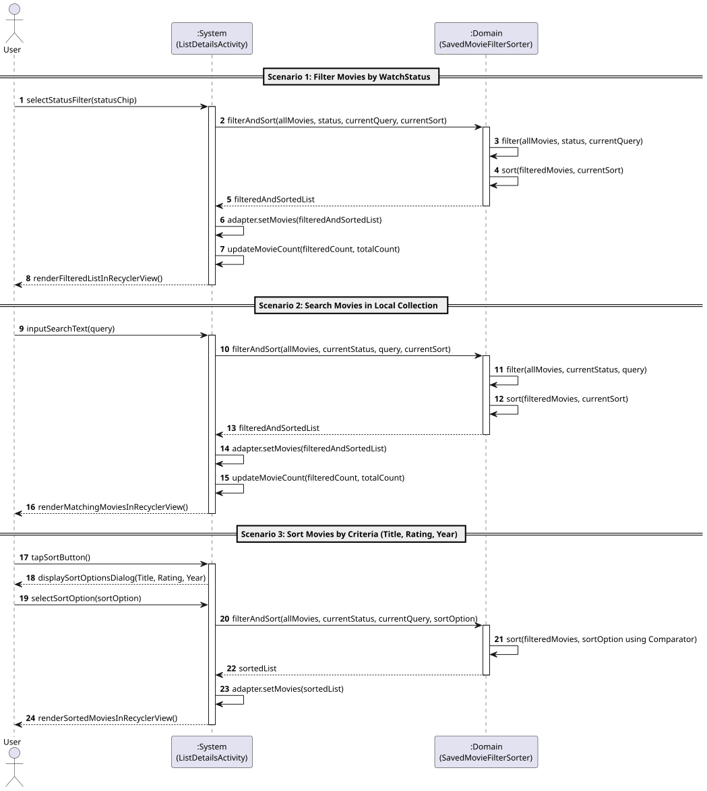
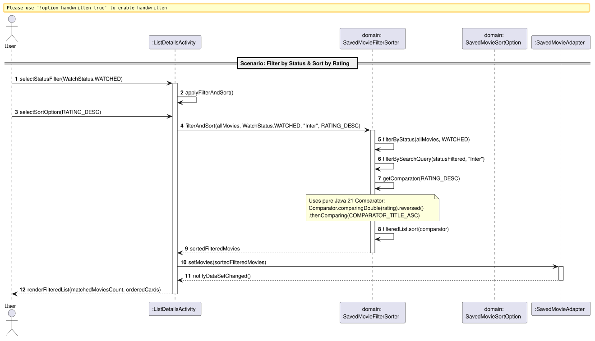

# US9: [Epic: CRUD] Filtragem e Ordenação da Coleção Local

## 1. Descrição do Caso de Uso / User Story
Como um utilizador autenticado no CineTrack, pretendo filtrar os filmes de uma lista por estado de visualização (*Plan to Watch*, *Watching*, *Watched*, *Favorite*) ou por pesquisa textual, e ordená-los segundo múltiplos critérios (ordem alfabética de título, melhor/pior classificação por estrelas, ano de lançamento mais recente/antigo), para que possa organizar e consultar rapidamente a minha coleção cinematográfica em memória com resposta instantânea e sem chamadas redundantes à rede.

---

## 2. Critérios de Aceitação (Acceptance Criteria)
* **AC01 — Lógica de Domínio Puro em Java 21:** Os algoritmos de ordenação e filtragem residem exclusivamente no pacote de domínio [`pt.isep.dssmv.projectdroid.model`](../../../src/main/java/pt/isep/dssmv/projectdroid/model/) através da classe de serviço puro [`SavedMovieFilterSorter.java`](../../../src/main/java/pt/isep/dssmv/projectdroid/model/SavedMovieFilterSorter.java) e do enumerador [`SavedMovieSortOption.java`](../../../src/main/java/pt/isep/dssmv/projectdroid/model/SavedMovieSortOption.java).
* **AC02 — Uso de `java.util.Comparator` Moderno:** As ordenações utilizam comparadores funcionais compostos com desempate determinístico (por título):
  * Título ascendente (`A-Z`) e descendente (`Z-A`), com indiferença de maiúsculas/minúsculas (`String.CASE_INSENSITIVE_ORDER`).
  * Classificação quantitativa por estrelas (`5.0 ★ -> 1.0 ★`), posicionando filmes não avaliados no final da listagem.
  * Ano de lançamento (`2026 -> 1900`).
* **AC03 — Filtragem Combinada por Estado e Pesquisa:** O filtro por [`WatchStatus`](../../../src/main/java/pt/isep/dssmv/projectdroid/model/WatchStatus.java) opera em conjunção com a caixa de pesquisa por título em tempo real (*TextWatcher*), preservando a lista original na memória.
* **AC04 — UI Reativa e Instantânea:** A aplicação dos filtros e ordenações é processada localmente em $0\text{ ms}$, atualizando o [`SavedMovieAdapter`](../../../src/main/java/pt/isep/dssmv/projectdroid/adapters/SavedMovieAdapter.java) via `notifyDataSetChanged()` sem bloquear a *UI Thread*.
* **AC05 — Contadores e Estados Vazios Dinâmicos:** A interface reflete dinamicamente a contagem de elementos exibidos (ex.: *"3 of 10 movies"*) e apresenta uma mensagem informativa dedicada quando nenhum filme cumpre os critérios filtrados.
* **AC06 — Cobertura de Testes Unitários:** O serviço de ordenação e filtragem é acompanhado por testes exaustivos em JUnit 5 ([`SavedMovieFilterSorterTest.java`](../../../src/test/java/pt/isep/dssmv/projectdroid/model/SavedMovieFilterSorterTest.java)), cobrindo ordenações, filtros, listas vazias e casos de fronteira com 100% de sucesso.

---

## 3. Pré-condições e Pós-condições
* **Pré-condições:** O utilizador deve aceder aos detalhes de uma lista na [`ListDetailsActivity`](../../../src/main/java/pt/isep/dssmv/projectdroid/controllers/ListDetailsActivity.java).
* **Pós-condições:** A lista apresentada no `RecyclerView` reflete os critérios de filtro e ordenação ativos sem alterar os dados persistidos no Cloud Firestore.

---

## 4. Fluxo Principal de Eventos
1. O utilizador acede a uma lista de filmes na `ListDetailsActivity`.
2. O sistema carrega os filmes da coleção e exibe a barra de ferramentas de filtro e ordenação no topo.
3. O utilizador clica num dos *chips* de estado (ex.: *"Watched"*).
4. O sistema invoca `SavedMovieFilterSorter.filterAndSort(...)` filtrando os filmes pelo estado correspondente.
5. O sistema atualiza o `SavedMovieAdapter` e o contador de filmes.
6. O utilizador clica no botão "Sort" e seleciona um critério no diálogo (ex.: *"Highest Rating (★ 5.0 - 1.0)"*).
7. O sistema reordena a lista filtrada usando o respetivo `Comparator<SavedMovie>`.
8. O `RecyclerView` atualiza a apresentação dos itens em $0\text{ ms}$.

---

## 5. Diagramas de Sequência

### 5.1. Diagrama de Sequência de Sistema (SSD — Nível de Análise)
Ficheiro PlantUML fonte: [`puml/ssd_us9_filter_sort.puml`](puml/ssd_us9_filter_sort.puml)

### 5.2. Diagrama de Sequência de Realização (SD — Nível de Design/Implementação)
Ficheiro PlantUML fonte: [`puml/sd_us9_filter_sort.puml`](puml/sd_us9_filter_sort.puml)

---

## 6. Mapeamento Arquitetural (MVC)
* **Model:** [`SavedMovieFilterSorter.java`](../../../src/main/java/pt/isep/dssmv/projectdroid/model/SavedMovieFilterSorter.java), [`SavedMovieSortOption.java`](../../../src/main/java/pt/isep/dssmv/projectdroid/model/SavedMovieSortOption.java), [`SavedMovie.java`](../../../src/main/java/pt/isep/dssmv/projectdroid/model/SavedMovie.java), [`WatchStatus.java`](../../../src/main/java/pt/isep/dssmv/projectdroid/model/WatchStatus.java) e [`Rating.java`](../../../src/main/java/pt/isep/dssmv/projectdroid/model/Rating.java).
* **View:** `res/layout/activity_list_details.xml` com barra de pesquisa `CardView`, botão `MaterialButton` de ordenação e `ChipGroup` com `Chip` para cada `WatchStatus`.
* **Adapter:** `SavedMovieAdapter.java` no pacote `pt.isep.dssmv.projectdroid.adapters`.
* **Controller:** `ListDetailsActivity.java` no pacote `pt.isep.dssmv.projectdroid.controllers`.
* **Tests:** `SavedMovieFilterSorterTest.java` no diretório `src/test/java/pt/isep/dssmv/projectdroid/model/`.
