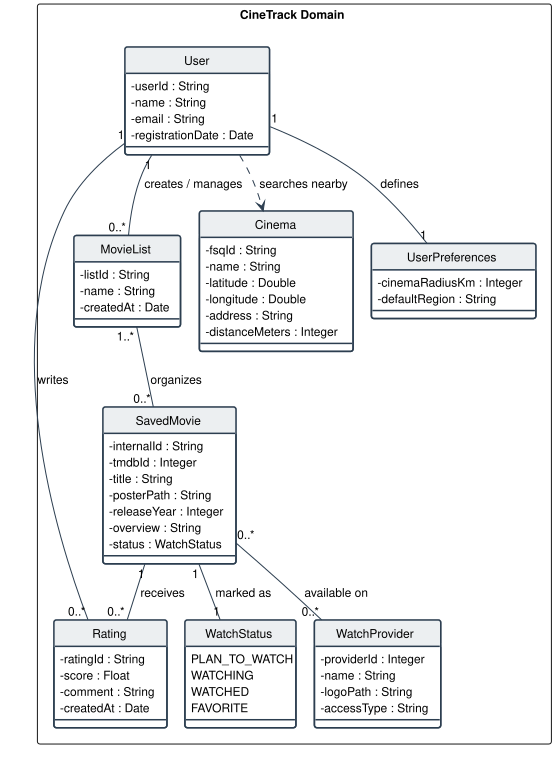
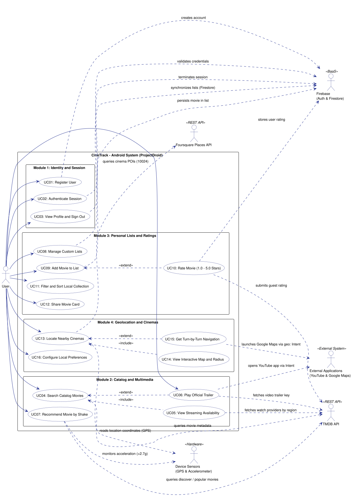
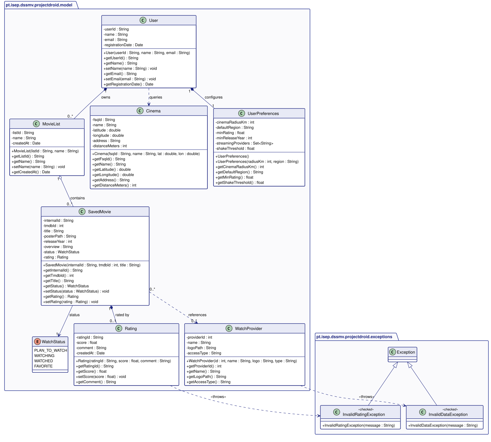
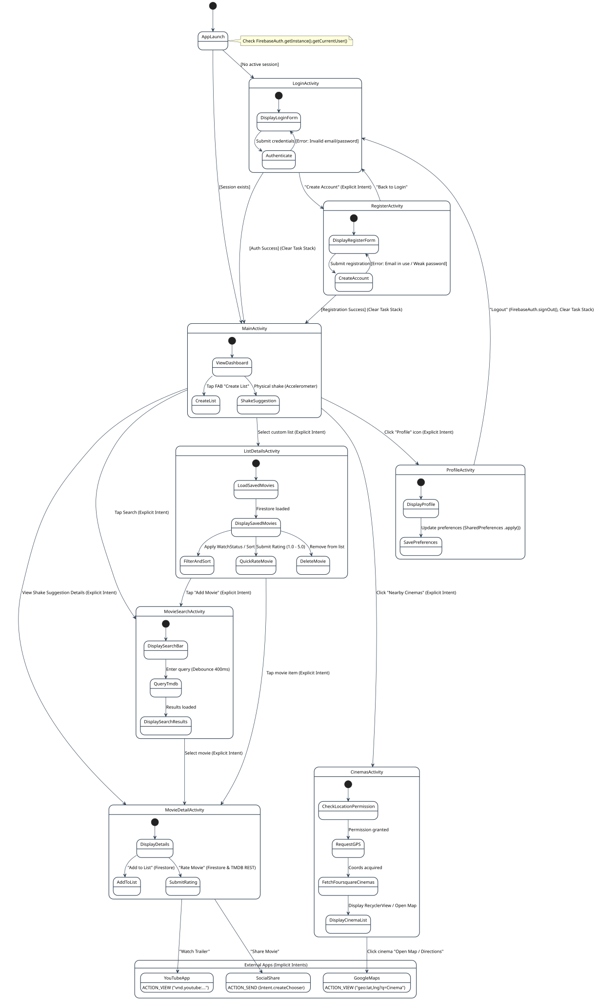

# CineTrack: Gestor Móvel de Filmes e Mapeamento Geoespacial de Cinemas

**André Silva (1240567)**, **Afonso Ferreira (1241013)**  
*Licenciatura em Engenharia de Telecomunicações e Informática (LETI)*  
*Instituto Superior de Engenharia do Porto (ISEP), Porto, Portugal*  
`{1240567, 1241013}@isep.ipp.pt`

---

## Resumo (Abstract)
O ecossistema de dispositivos móveis exige aplicações eficientes, reativas e com forte respeito pelos recursos limitados do hardware, tais como a autonomia da bateria e o tempo de resposta da interface gráfica (*UI Thread*). Este relatório técnico descreve a conceção, arquitetura, implementação e verificação da aplicação Android nativa **CineTrack** (*ProjectDroid*), desenvolvida no âmbito da unidade curricular de Desenvolvimento de Software e Sistemas Móveis (DSSMV). O sistema permite a gestão de catálogos cinematográficos personalizados, integração com serviços REST externos (*The Movie Database* e *Foursquare Places API*), persistência remota no Firebase (Authentication e Cloud Firestore), bem como o aproveitamento de sensores nativos (GPS e acelerómetro para a funcionalidade *Shake to Suggest*). O desenvolvimento adota uma abordagem estrita orientada a especificações (*Documentation-First*), com implementação em Java 21 nativo puro na camada de Domínio, arquitetura Model-View-Controller (MVC) e conformidade total com as boas práticas de programação móvel.

**Palavras-chave:** Android, Java 21, Arquitetura MVC, Firebase, Retrofit, Sensores Móveis, TMDB, Foursquare, JUnit 5, DSSMV.

---

## 1. Contexto e Âmbito do Projeto (Context)

A proliferação de plataformas de distribuição de conteúdos em streaming originou uma fragmentação significativa na experiência do utilizador que procura obras cinematográficas e informação sobre salas de cinema locais. O projeto **CineTrack** visa responder a este desafio através de uma solução móvel consolidada e fluida.

Do ponto de vista pedagógico e de engenharia de software na UC de DSSMV (LETI/ISEP), o CineTrack corporiza os princípios fundamentais da programação para sistemas móveis:
1. **Separação de Responsabilidades (MVC):** Utilização do padrão arquitetural Model-View-Controller (MVC), garantindo a pureza do Modelo em Java 21 e o isolamento total das regras de negócio relativamente ao Android SDK.
2. **Respeito pela UI Thread:** Execução assíncrona mandatória para operações de rede (Retrofit 2), persistência remota (Cloud Firestore) e persistência local (`SharedPreferences` com `.apply()`), prevenindo o bloqueio da interface gráfica e mensagens de erro do tipo *Application Not Responding* (ANR).
3. **Disciplina no Ciclo de Vida dos Sensores:** Registo rigoroso dos listeners do acelerómetro e do GPS no método `onResume()` das Activities e cancelamento imediato em `onPause()`, salvaguardando a autonomia energética da bateria.
4. **Design Adaptativo e Responsivo:** Construção de interfaces gráficas em XML estritamente baseadas em unidades independentes de densidade (`dp`) e escala (`sp`).

A matriz de implementação cobriu 11 User Stories organizadas em fluxo colaborativo via Git Feature Branch (`andre-1240567` e `afonso-1241013`), integradas na branch `main` através de Pull Requests validados por testes.

---

## 2. Análise de Requisitos e Domínio (Analysis)

### 2.1. Requisitos Funcionais (RF)
* **RF01 — Registar e Autenticar Utilizador (Issue #1):** O sistema deve autenticar e registar utilizadores através de credenciais de email e palavra-passe via Firebase Authentication.
* **RF02 — Criar e Gerir Listas de Filmes (Issue #2):** O utilizador deve poder criar, consultar e remover coleções personalizadas no Cloud Firestore.
* **RF03 — Adicionar Filmes e Submeter Avaliações (Issue #3):** Deve ser possível associar instâncias de filmes a listas e submeter notas de 1.0 a 5.0 estrelas com comentário descritivo.
* **RF04 — Pesquisa de Filmes e Provedores de Streaming (Issue #4):** O sistema deve consultar o catálogo do TMDB e listar as plataformas de streaming ativas em Portugal para cada filme.
* **RF05 — Localizar Cinemas Próximos (Issue #5):** Mapeamento dinâmico de cinemas em redor com base nas coordenadas GPS obtidas pelo dispositivo e na Foursquare Places API.
* **RF06 — Sugestão Aleatória ao Agitar o Dispositivo (Issue #6):** Recomendação instantânea de um filme do catálogo mediante deteção de movimento brusco via acelerómetro nativo (*Shake to Suggest*).
* **RF07 — Gestão de Perfil e Estatísticas da Biblioteca (Issue #7):** Exibição de dados do utilizador autenticado, cartões estatísticos de consumo cinematográfico e encerramento seguro de sessão no Firebase.
* **RF08 — Guardar Preferências Locais (Issue #8):** Gravação permanente de definições leves (raio de busca de cinemas e país padrão) via `SharedPreferences` assíncrono com `.apply()`.
* **RF09 — Filtragem e Ordenação da Coleção (Issue #9):** Ordenação alfabética, por nota e filtragem por estado de visualização na camada de domínio.
* **RF10 — Visualização de Trailers Oficiais (Issue #10):** Abertura de trailers oficiais do YouTube utilizando *Implicit Intent* com fallback defensivo.
* **RF11 — Partilha Externa de Fichas de Filmes (Issue #11):** Partilha formatada de resumos de filmes para redes e mensageiros através de `Intent.ACTION_SEND` e `Intent.createChooser()`.

### 2.2. Modelo de Domínio Concetual
O modelo conceptual define as entidades nucleares do sistema e as suas invariantes de negócio:

*Invariantes de Domínio:*
* A nota de uma avaliação (`Rating`) encontra-se estritamente limitada ao intervalo $[1.0, 5.0]$ estrelas.
* O estado de visualização (`WatchStatus`) obedece à enumeração: `PLAN_TO_WATCH`, `WATCHING`, `WATCHED`, `FAVORITE`.
* O raio de pesquisa de cinemas situa-se entre $1 \text{ km}$ e $100 \text{ km}$.

### 2.3. Diagrama Global de Casos de Uso (UCD)
O sistema decompõe-se funcionalmente em quatro módulos nucleares integrados com serviços em nuvem e hardware:

---

## 3. Design e Arquitetura de Software (Design)

### 3.1. Diagrama de Classes de Implementação (Model Layer)
A camada de domínio em `pt.isep.dssmv.projectdroid.model` foi desenvolvida em Java 21 puro, sem qualquer dependência do Android SDK:

### 3.2. Fluxo de Navegação e Interface (UI Flow Diagram)
O grafo de estados documenta a navegação explícita entre as 8 Activities do sistema e a delegação de tarefas a aplicações externas através de *Implicit Intents*:

### 3.3. Diagramas de Sequência (SSD e SD de Realização)
Cada caso de uso dispõe de especificação comportamental formal:
* **SSD (System Sequence Diagram):** Perspetiva de caixa negra (*Black-box*) especificando as interações Utilizador $\leftrightarrow$ Sistema.
* **SD (Design Sequence Diagram):** Perspetiva de caixa branca (*White-box*) detalhando o ciclo de vida MVC, chamadas Retrofit com `.enqueue()`, persistência assíncrona e mapeamentos de domínio.

A título demonstrativo, o diagrama seguinte ilustra a realização técnica do caso de uso **US5 (Mapeamento Geoespacial de Cinemas com GPS, Foursquare e OSMDroid)**:

*(Os diagramas individuais de todos os 11 casos de uso encontram-se organizados nas pastas dedicadas [`../Use Cases/US1/`](../Use%20Cases/US1/) a [`../Use Cases/US11/`](../Use%20Cases/US11/)).*

---

## 4. Implementação do Sistema (Implementation)

1. **Java 21 Nativo Puro no Domínio:** Garante portabilidade, testabilidade unitária sem recurso a mocks de Android e desacoplamento total da lógica de negócio.
2. **Firebase Auth & Cloud Firestore:** Autenticação de utilizadores e base de dados documental NoSQL sincronizada em tempo real via listeners assíncronos.
3. **Retrofit 2 com Gson:** Abstração de chamadas REST assíncronas (`.enqueue(Callback<T>)`) com serialização tipada para a TMDB API e Foursquare Places API.
4. **Mapeamento OpenStreetMap (OSMDroid):** Renderização de mapas sem custos de licença ou chaves Google Cloud, com overlay de circunferência translúcida para representação do raio de busca (`Polygon`) e marcadores interativos (`Marker`).
5. **Acelerómetro com Gestão do Ciclo de Vida:** O registo do listener do sensor em `onResume()` e respetiva desativação em `onPause()` protege a integridade da bateria do dispositivo móvel.
6. **Mutações REST com HTTP POST e DELETE no TMDB:** Para além do consumo de catálogo via GET, a aplicação implementa mutações REST com submissão de avaliações via `POST /3/movie/{id}/rating` (com corpo JSON `@Body` serializado por Gson) e remoção via `DELETE`, recorrendo a *Guest Sessions* geridas automaticamente em `SharedPrefManager`.
7. **Comparadores Funcionais Java 21 e Implicit Intents:** Implementação de filtragem e ordenação em memória no Modelo puro (`SavedMovieFilterSorter`) com resposta em $0\text{ ms}$ sem tráfego de dados, e partilha social via *Implicit Intent* (`ACTION_SEND` com `Intent.createChooser()`).
8. **Monitorização de Conectividade e Notificações:** Implementação de `NetworkMonitor` (via `ConnectivityManager.NetworkCallback`) para banner offline em tempo real e `NotificationHelper` com canais de notificação (`NotificationChannel`) e `PendingIntent` compatíveis com Android 13+ (permissão `POST_NOTIFICATIONS`).

---

## 5. Testes e Garantia de Qualidade (Tests)

### 5.1. Estratégia de Testabilidade
A pureza arquitetural da camada de Modelo permitiu a execução de uma suite exaustiva de testes unitários diretamente na Java Virtual Machine (JVM) local, sem dependência de emuladores ou dispositivos físicos lentos.

### 5.2. Cobertura da Suite de Testes Automatizados (JUnit 5)
A suite é composta por **15 classes de teste**, totalizando **74 testes unitários** com **100% de taxa de sucesso**:

| Classe de Teste | Pacote | Nº Testes | Taxa Sucesso | Componente Sob Teste |
| :--- | :--- | :---: | :---: | :--- |
| `CinemaTest` | `model` | 4 | 100% Pass | Invariantes de POI, coordenadas e raio |
| `MovieListTest` | `model` | 3 | 100% Pass | Gestão de coleções e datas de criação |
| `MovieShareFormatterTest` | `model` | 8 | 100% Pass | Formatação de partilha social (US11) |
| `RatingTest` | `model` | 5 | 100% Pass | Limites do intervalo $[1.0, 5.0]$ e comentários |
| `SavedMovieFilterSorterTest` | `model` | 10 | 100% Pass | Comparadores funcionais e ordenação (US9) |
| `SavedMovieTest` | `model` | 5 | 100% Pass | Identidade, equals/hashCode e WatchStatus |
| `UserMovieStatsTest` | `model` | 3 | 100% Pass | Estatísticas da coleção e médias |
| `UserPreferencesTest` | `model` | 13 | 100% Pass | Limites e validações de SharedPreferences (US8) |
| `UserTest` | `model` | 5 | 100% Pass | Validações de conta, UID e email |
| `WatchProviderTest` | `model` | 5 | 100% Pass | Entidade de provedores de streaming (US4) |
| `FsqPlaceDtoTest` | `network` | 3 | 100% Pass | Deserialização JSON da Foursquare Places API |
| `TmdbMovieDtoTest` | `network` | 2 | 100% Pass | Deserialização de filmes do TMDB |
| `TmdbRatingDtoTest` | `network` | 3 | 100% Pass | Deserialização de respostas de avaliação TMDB |
| `TmdbRatingIntegrationTest` | `network` | 1 | 100% Pass | Integração de sessão de convidado TMDB |
| `TmdbVideosResponseTest` | `network` | 4 | 100% Pass | Extração de chaves de trailer YouTube (US10) |
| **Total** | | **74** | **100% Pass** | **0 Falhas / 0 Erros / 0 Ignorados** |

### 5.3. Validação em Dispositivos Físicos
Para além dos testes unitários na JVM, a aplicação foi testada em dispositivos reais com Android 14 (API 34) e Android 15 (API 35):
* **Sensibilidade do Acelerómetro:** Calibração do limiar ($>2.7g$) para filtrar movimentos involuntários de marcha e responder a agitações deliberadas com vibração háptica e sugestão aleatória.
* **Geolocalização e Mapa OSMDroid:** Validação de coordenadas GPS em tempo real e renderização precisa de cinemas da Foursquare e da circunferência de raio.
* **Resiliência a Quebras de Rede:** Validação do comportamento da aplicação em modo offline através do `NetworkMonitor`.

---

## 6. Conclusão

O projeto **CineTrack** cumpre na íntegra todos os objetivos estipulados para a unidade curricular de DSSMV:
* **Conformidade Arquitetural:** 100% compatível com as regras de separação MVC, pureza de domínio e uso exclusivo de `.apply()` no armazenamento local.
* **Qualidade de Código e Testes:** 74 testes unitários automatizados cobrindo exaustivamente o modelo, comparadores e DTOs de rede.
* **Experiência de Utilizador Móvel:** Interface fluida, sem bloqueios na UI Thread, com respeito total pelo ciclo de vida do dispositivo e pela autonomia da bateria.

---

## 7. Referências Bibliográficas

1. Horstmann, C. S.: *Big Java: Early Objects*, 6th Edition. Wiley (2015).
2. Android Developers Documentation: *Processes and Application Lifecycle*. [developer.android.com](https://developer.android.com).
3. TMDB API Documentation: *The Movie Database REST API v3*. [developer.themoviedb.org](https://developer.themoviedb.org).
4. Foursquare Places API: *Places API Documentation*. [location.foursquare.com](https://location.foursquare.com).
5. OSMDroid Documentation: *OpenStreetMap-Tools for Android*. [osmdroid.net](https://osmdroid.net).
